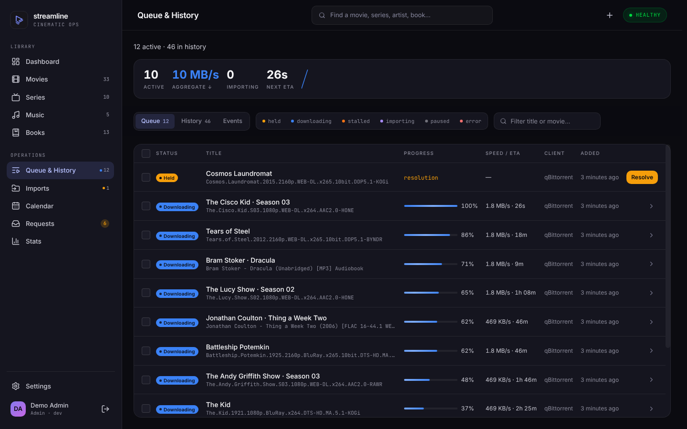
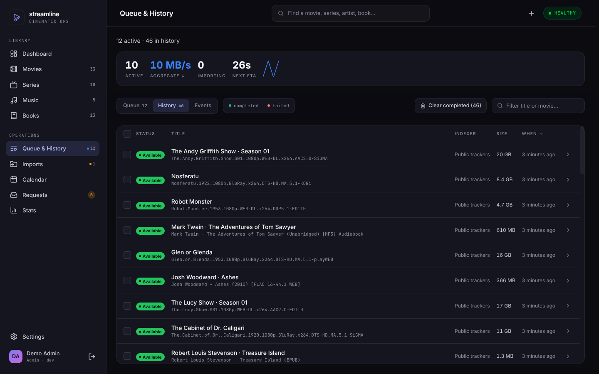
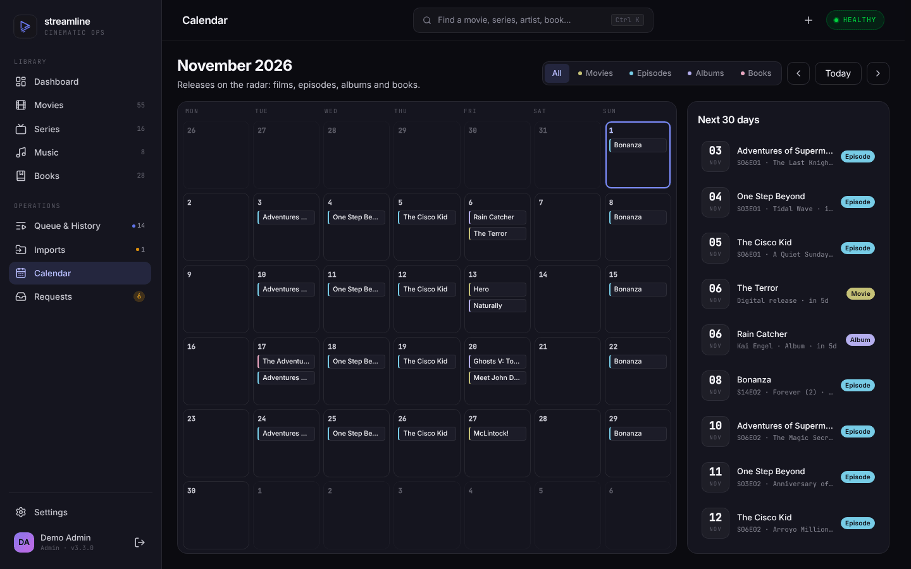

# Activity and Calendar

Where to look when you want to know what Streamline is doing, what it did, and what's coming.

| | | |
| --- | --- | --- |
|  |  |  |
| **Doing** — live queue, progress and ETA | **Did** — every grab and its source | **Coming** — upcoming episodes and releases |

- [Dashboard](#dashboard)
- [The event feed](#the-event-feed)
- [The queue](#the-queue)
- [History](#history)
- [Adopted torrents](#adopted-torrents)
- [Metadata changes](#metadata-changes)
- [Torrents (built-in client)](#torrents-built-in-client)
- [Transcoding](#transcoding)
- [Calendar](#calendar)
- [Stats](#stats)

---

## Dashboard

The landing page, across all four libraries. **Needs you** lists what is waiting on a decision (held downloads, pending requests, import scans awaiting review, metadata changes, movies marked failed), the arrivals shelf shows what landed most recently — movies, episodes, albums and books alike, newest first — beside the library counts, what's downloading right now and what's coming up. A request-only account sees the state of its own requests in place of *Needs you* and the queue.

The health indicator in the top bar (admins, not on a phone) reflects real state — disk usage on the data and database volumes, serving over plain HTTP, ffprobe not found while `ffmpeg.enabled` is on, a Hardcover key that was refused, and a [library root that looks gone](Troubleshooting#a-library-root-is-offline). If it's not green, something on the [Troubleshooting](Troubleshooting) page probably applies.

---

## The event feed

The **Events** view of the Queue & History page, and `GET /api/v1/activity` behind it, is the history of what happened to each title. Events cover movies, episodes, series, artists, albums, books and book series, and every detail page — movie, series, artist, book, book series — has a **History** tab showing its own slice of the feed:

| Event | When it fires |
| --- | --- |
| `added` | A movie, series, artist, book or book series entered the library |
| `grabbed` | A release was sent to the download client |
| `download_completed` | The bytes arrived and the import is starting |
| `download_failed` | That download failed |
| `download_cancelled` | You cancelled or removed the download — of a movie, episode, album, book or discography pack — and the title went back to wanted at once (or to available, when it already had its files and the grab was an upgrade) |
| `grab_widened` | More episodes were added to a torrent already in flight |
| `imported` | A file landed in the library |
| `import_failed` | A bulk-import entry failed (a movie, series, album or book entry) |
| `import_held_for_review` | Import verification failed and the download is parked, waiting on your decision |
| `file_renamed` | A file was moved by a rename pass |
| `file_removed` | A file left the library — deleted by hand, replaced by an upgrade, or swapped in a bulk-import commit |
| `drift_detected` | A tracked file went missing from disk |
| `drift_confirmed` | It stayed missing past the grace window. The title keeps its status, with a mark, until the re-download wait ends |
| `drift_reverted` | The wait ended with the file still missing: its record went and the title went back to wanted |
| `drift_recovered` | A file confirmed missing came back and healed |
| `reidentified` | A title was re-pointed at different metadata |
| `metadata_refreshed` | A provider refresh gave a movie a new title or year, or a series a new title |
| `monitoring_changed` | Monitoring was turned on or off, or an artist or book series got a new monitor policy |
| `request_approved` | Someone's request was approved and the title was added |
| `transcode_completed` / `transcode_failed` / `transcode_rejected` | A transcode finished, gave up, or produced output that failed verification |
| `searched` | A search-and-grab pass ran |

Every event names exactly one owner — `movie`, `episode`, `series`, `artist`, `album`, `book` or `book_series`. Episode rows render as *Show · S01E03*, album rows as *Artist · Album*, a series volume as *Series · Vol. 3*, and a book row names the slot (ebook or audiobook) it was about.

**Music and books follow the same rules one level up.** An album is the unit a grab and an import cover, so importing a twelve-track album is one `imported` row on the album (with the track count), never twelve, replacing an album's or an audiobook's files is one `file_removed` row, and a drift check that finds an album's or a book slot's files gone writes one `drift_detected` and one `drift_confirmed` row for it. A discography pack is filed against its artist; everything else lands on the album. Adding an artist is one `added` row — the albums it seeds are not each an arrival — and adding a book series is one row for the series, not one per volume. An artist's History tab shows its own rows and every album's; a book series' shows its own and every volume's. Automatic and *Search now* passes write one `searched` row per album, per book slot, and per series-wide pass. Changing an artist's monitor policy is one row saying how many albums it moved — *Boards of Canada · 13 albums · Monitored* — and a book series' policy one row with its volume count; a single album or book toggle gets its own row, and a patch that changes nothing writes none.

**`searched` is recorded once per search, not once per episode.** Asking Streamline to search a series writes one event for the whole pass, with the seasons it touched, how many episodes it searched and how many it grabbed in the payload. A pass over one season reads as *Show · Season 3*. Without that, a `tv-missing-search` tick over a large library would write thousands of rows an hour.

**Monitoring a season or a whole series is likewise one event, not one per episode.** Turning a series off writes a single row saying how many episodes it moved — *Lupin · 25 episodes* — and a season toggle reads as *Lupin · Season 1 · 10 episodes*. Toggling one episode on its own still gets its own row, since that is a single deliberate action.

**Renames, bulk imports, season-pack imports, widened grabs and drift on a series show as one event per series.** Like searches, a series rename, bulk-import commit, season-pack import, grab widened across episodes, or drift detection sweep writes a single event naming the seasons involved and episode count — *Show · Season 2 · 12 episodes* in the details — instead of one row per file or episode. This keeps the activity feed readable when operations span many files.

Browsing releases in the manual-grab dialog records nothing — no grab happened, and the results are already on screen. The grab that follows still fires `grabbed`.

Rows are purged by the `cleanup` job after `events.retention` (default 90 days).

---

## The queue

**Queue & History → Queue.** A live snapshot of everything currently downloading, read from your download clients every 2 seconds while the page is open. Each row shows progress, speed, ETA, size, which download client is handling it, and what it's for. Held and errored entries waiting on you come first, then imports, then downloads furthest along first, then stalled and paused ones.

An admin can **pause**, **resume** and **cancel** items directly — these act on your actual download client, so pausing here pauses in qBittorrent. Cancelling asks first, then removes the torrent and its partial files from the client; the title goes back to wanted if it has no file yet. Members see the queue without these actions.

To act on several at once, tick their checkboxes (or the header box for every row the filters show) and use the bar that appears at the bottom: **Pause**, **Resume** or **Cancel download**. On a phone, press and hold a row to start selecting, then tap the others. Each action only touches the entries it applies to — Pause skips what is already paused, Resume takes only paused entries, and **held** entries are left out of all three, since resolving them is a decision per entry.

On a phone, swipe a row sideways for a shortcut. Swipe right to **pause** or **resume** it (in the history, to **retry the import** of a failed entry), and swipe left to **cancel** the download (in the history, to **remove** the entry). Let go once the colour fills in; short of that, the row springs back. Cancel, retry and remove still ask first, in the same words as the row's sheet, and held entries have no swipe.

A queue entry is in one of six states:

| Status | Meaning |
| --- | --- |
| **Downloading** | Normal progress |
| **Stalled** | The download client reports the download is not moving — usually no peers |
| **Importing** | Downloaded; Streamline is moving it into your library |
| **Held** | Downloaded, but it failed import verification and is waiting on your decision |
| **Paused** | Suspended, by you or by the client |
| **Error** | Something failed — the entry carries a failure reason |

**Held** entries are the only ones whose next move is yours. Streamline probed the finished file and it disagrees with what the release claimed — a 720p file sold as 1080p, a truncated runtime, a codec your profile doesn't allow, or a file ffprobe cannot read at all. An album is also held when its files don't line up with its tracks, and a discography pack when its folders don't line up with its albums (see [Searching and grabbing](Music-and-Books#searching-and-grabbing)). Nothing was moved into your library. Open the entry and choose: **import anyway**, or delete it — with or without searching for a replacement. Deleting it marks the release as rejected for that title: the automatic searches and the RSS feeds skip it from then on and take the next-best release, while a manual search still lists it if you want it after all. Retrying or removing the entry in **History** lifts the rejection. A season pack is held whole, listing every file that failed.

A download whose files are at neither of the paths Streamline looks in is held too, with the reason `location` and both paths. That one can't be imported as it is: it imports by itself once the files are at either path, so fix the client's save path or add a download path mapping.

See [Configuration Reference](Configuration-Reference#import-verification) for the checks and how to turn them up or off (including `always_ask`, which holds every import for review).

> [!TIP]
> A torrent stuck at the same percentage with no speed has no peers. Remove it and let Streamline find another release, or search manually and pick one with more seeders.

---

## History

**Queue & History → History.** Every finished download, completed or failed, newest first. What else happened to a title (renames, deletions, metadata refreshes) is in the [Events](#the-event-feed) view.

Filter by status, or by title or release name, and scroll back through time. This is where you find *why* something failed — an import error records the actual reason (permission denied, cross-device link, destination exists), which is far more useful than the status word on the queue.

**Retry import** is on any failed entry: expand the row and it hands the record back to the importer with a clean attempt counter. Use it once you've fixed whatever the failure reason names — it reads the same files as before, so retrying an unchanged failure just fails again. The movie, episode or album comes back to *importing* with it.

Select entries the same way as on the queue to **remove** several history records at once; the titles and their files are not touched.

**Clear completed** tidies out successful entries and leaves the failures. An entry whose torrent is still seeding stays, completed or failed, both here and in the automatic clean-up (completed entries after 30 days, failed ones after 14): without it, Streamline would no longer recognise the torrent as its own and list it under *Needs attention*. Events also age out on their own after `events.retention` (default 90 days).

---

## Adopted torrents

This one is worth understanding because it looks like a bug the first time you see it.

Streamline only manages torrents tagged with the category/label `streamline`. If you add a torrent to that category **yourself**, Streamline notices it and tries to work out what it is.

When it can safely tell — and the file is a clean upgrade or a straightforward addition — it just imports it. When it *can't* be sure, it doesn't guess. It parks it as a **proposal** awaiting your decision, and the sidebar flags *"Adopted torrents need attention"*.

One case is settled without asking: a torrent whose payload is the very file already in your library — same size, and nothing in its name contradicting what Streamline recorded at import — is filed straight into history as completed. That is what a torrent left seeding after its record was lost looks like, and a proposal for it would only ever be dismissed.

Proposals come up when:

- The resolution is below your quality profile's minimum
- A different file already exists for that title
- The match is ambiguous
- It's a season pack that doesn't map cleanly onto what you're missing
- **Streamline can't find the files** — the reason reads `files not found — client reports <path>`. The torrent is in the `streamline` category but its data is somewhere else, which is what tagging a qBittorrent torrent without Automatic Torrent Management does. See [Troubleshooting](Troubleshooting#an-adopted-torrent-says-files-not-found)

Three actions per proposal:

| Action | Effect |
| --- | --- |
| **Import** | Accept it and import as-is |
| **Replace** | Import this one in place of the existing file, which is deleted. Optionally also remove the old torrent from your download client |
| **Ignore** | Dismiss it. Optionally also remove the torrent from your download client |

A row offers Import or Replace, whichever applies. A pack that both fills gaps and beats files you have offers the two: Import takes only the gaps, Replace also the episodes it beats.

Ignore is permanent for that proposal — it won't be offered again.

### Torrents for something you don't track yet

You don't have to add the title first. A torrent matching nothing in your library shows up as a proposal too, marked *unidentified*, with an **Identify** action:

1. Say whether it's a movie, a series, an album or a book — Streamline guesses from the release name.
2. Pick the title from the usual search — TMDB/TVDB for video, MusicBrainz for an album, Hardcover for a book — pre-filled from the name.

The title is added to your library if it isn't there already, and the download is matched to it. Nothing is imported at that point — the proposal stays put, now showing Import or Replace like any other.

**Forget** drops an unidentified proposal and leaves the torrent alone, so the next pass matches it again: use it after adding the title yourself. When there are several, one button above the list forgets them all.

Adding a series this way monitors it, exactly as adding it by hand would, so Streamline will start looking for its other missing episodes. Unmonitor the seasons you don't want if that's not what you're after. An album's artist is added under the *manual* policy instead, so nothing else in its discography is monitored, and a book is added with only the slot the download fills (ebook, or audiobook when the name says so) monitored. Identifying a book needs a Hardcover key.

---

## Metadata changes

**Metadata changes** (in the sidebar's Operations group, at `/metadata-changes`). Admin only.

Every metadata refresh, scheduled or asked for on a title's page, updates your library from TMDB, TVDB, MusicBrainz and Hardcover on its own: titles, dates, lengths, artwork, credits, and anything you hold no files for. It stops and asks you only when a change would alter what your files are matched against, or take something out of your library:

- **Music** — the edition an album follows was merged or removed, MusicBrainz now prefers another edition of an album you have files for, a track holding a file left the tracklist, an album or artist was merged or removed.
- **Series** — episodes or a season you have files for are no longer listed by TVDB, or TVDB no longer knows the series.
- **Movies** — TMDB no longer knows the movie.
- **Books** — Hardcover no longer knows the book, or no longer has the edition a format you have a file for follows.

Each change shows what you have next to what the provider says now, and offers **Follow** (apply it), **Keep as is** (leave the item as it is; you are not asked about that change again, only if the provider changes the same thing differently), and where it applies **Pick another edition…**, **Find it again…** (point a movie or series at another TMDB/TVDB entry) or **Remove from library…**. Following never deletes a file: tracks and episodes it removes leave their files on disk, untracked.

An item waiting on a decision carries a **Changed** (amber) or **Removed** (red) badge on its cover, and its page opens with the same choices. The dashboard's *Needs you* strip counts them.

---

## Torrents (built-in client)

**Torrents** (in the sidebar's Operations group, at `/torrents`). Admin only, and only relevant if you're running Streamline's built-in torrent engine (`client_type: builtin`). The entry appears in the navigation only while an enabled built-in client is configured.

**Add torrent** takes a magnet link or a `.torrent` file; what you add that way is matched to your library like any [adopted torrent](#adopted-torrents).

Live view of the engine's torrents: peers, pieces, ratio, up/down rates. You can pause and resume individual torrents, and toggle individual **files** within a torrent on and off — handy for a season pack where you only want three episodes.

A torrent is listed under the name inside its `.torrent` file, which the uploader chose and which can differ from the release name shown in Queue and History — a RuTracker upload of an album is often just the artist's name. For a torrent Streamline grabbed, the release name appears under the torrent's own, and the search box matches either one (or the infohash).

A torrent marked **Checking** is re-reading data it already has, to make sure it is intact. This happens to every unfinished download after Streamline restarts: its percentage climbs back to where it was, nothing is downloaded meanwhile, and it then carries on (or shows **Stalled** if no peer is connected).

Tick several torrents (or press and hold one on a phone) to **pause**, **resume** or **remove** them together. Removing asks once whether to delete the downloaded files too, and any download Streamline was tracking for a removed torrent goes back to wanted. Removing a single tracked torrent also offers to blocklist its release, so the automatic searches and feeds don't grab it again for that title.

When the files of a removed torrent could not be deleted, a banner on the page lists them with the error; Streamline tries again every minute and when it starts.

On a phone, swipe a torrent right to **pause** or **resume** it, or left to **remove** it, which asks the same question about its files.

A torrent's details open at their own address (`/torrents?hash=<info hash>`), so a reload keeps the drawer open and the link can be shared or bookmarked. From the **Queue** or **History**, an admin opens a download's details (expand the row, or tap it on a phone) and follows **Open torrent** to land on that torrent's drawer. The button shows only while the built-in engine still lists the torrent.

With only qBittorrent, Transmission or Deluge configured the page is not offered at all; manage those torrents in their own UI or from the Queue.

---

## Transcoding

**Transcoding** (in the sidebar's Operations group, at `/transcoding`). Admin only. The queue of files being re-encoded in the background, driven by the `transcode` block on a [quality profile](Quality-Profiles-and-Custom-Formats#transcoding-a-profiles-files).

> [!NOTE]
> Transcoding is **off by default**, and the Transcoding entry is left out of the navigation and the search until you turn it on under Settings → Transcoding. Opened by its address while off, the page shows an off state rather than an empty queue — there's a difference between "nothing to do" and "not running", and the page says which.

Each row names the movie or episode, the file on disk, and where the job got to:

| Status | Meaning |
| --- | --- |
| **Queued** | Waiting for a free slot. `max_concurrent` decides how many run at once. A deferred job — waiting for seeding to end when `transcoding.defer_seeding` is on — shows the next re-check time as a hint |
| **Running** | Encoding now, with a live percentage, speed and ETA |
| **Succeeded** | The file on disk has been replaced. The row shows the size before and after |
| **Failed** | Out of attempts, or failed once in a way no retry can fix. The row carries the tail of ffmpeg's own error output |
| **Rejected** | The encode finished but failed verification (size band, health check, VMAF); the original is untouched. Terminal until retried |
| **Canceled** | You stopped it, it was queued when you did, or the file changed under the encode. Terminal — see below |

**Cancel** stops a running encode and throws away the partial output — the original file is untouched, so cancelling is always safe. The one exception is a cancel that arrives in the last moment before the swap: by then the encode is finished and the job completes rather than discarding good work.

**A canceled job is a dead end.** Only **failed** and **rejected** jobs can be retried, and nothing re-queues a canceled one — not the next import, not a restart. The way back is **Scan library**, which finds the file again if it still doesn't comply. Streamline cancels a job on its own in one case: the file changed underneath a running encode (a replacement was imported, or it was renamed), which makes the encode's output the wrong bytes to swap in.

**Retry** puts a failed or rejected job back in the queue with its attempt count reset. Fix whatever the error names first — a job that failed because the disk was full will fail the same way again.

> [!WARNING]
> A job that finished its encode, swapped the new file in, and *then* failed to record that in the database is parked as failed immediately, with no attempts left and a CRITICAL line in the log naming both paths. The file on disk has already been replaced, so a retry would re-encode from a source that is gone. Read the log line and reconcile the row by hand — the error text says which path the database still points at.

A running job's progress comes from the encoder inside the running process, so it disappears if Streamline restarts mid-encode. That job is put back in the queue on the next boot and starts over; the half-written file it left behind is cleaned up automatically.

**Scan library** (on this page and on Settings → Transcoding) re-probes every file whose profile has a `transcode` block and queues the ones that don't comply. Files that arrived before you turned transcoding on — or before you wrote the rules — are only reachable this way; new imports queue themselves. It's a full pass over your library, so it's a deliberate button rather than a schedule.

---

## Calendar

**Calendar.** A month grid plus an agenda view of what's on the horizon, covering four kinds of event:

- **Movie releases** — for wanted films, the date they become available digitally in your `metadata.tmdb_region`, labelled *Digital release*. This is why setting the region correctly matters: leave it wrong and your calendar shows another country's release schedule. TMDB only publishes a digital date once a film is actually buyable, so a title still in cinemas shows its theatrical date instead, labelled *In cinemas*.
- **Episode air dates** — upcoming episodes of the shows you're tracking.
- **Album releases** — monitored albums of the artists you follow, on their MusicBrainz release date.
- **Book releases** — books with either slot monitored, series volumes included, on their Hardcover release date.

Filter chips switch between all / movies / episodes / albums / books. A day holding more than three entries opens the rest from its **+N more**; on a phone, tap a day to list what lands on it. Click an entry to jump to the title.

> [!NOTE]
> The calendar is a *forecast*, not a queue. An entry appearing today doesn't mean Streamline has grabbed it — it means the release date has arrived and the next RSS sync or missing search is now likely to find something.

Weeks start on Monday regardless of locale.

---

## Stats

Admins get a **Stats** page, under Operations in the sidebar. The 7, 30 and 90 day selector sits above Pipeline and stays in view through it and Users and requests, the two sections it changes:

- **Library**: titles, files, disk use and what is wanted per medium, each library folder's volume, the resolution, codec, dynamic range and audio of your video files, and the five largest files. These are always the current state, whichever view you pick.
- **Pipeline**: grabs, imports and failures per day against the period before, the search → grab → download → import funnel, the time from grab to import, why grabs failed, how each indexer does, transcoding and drift.
- **Users and requests**: how many requests came in, what still waits, how long a decision and an arrival take, and every account with its requests and when it was last seen.

The pipeline counts what grabs brought in, so a bulk import or an adopted file is not in its imports. Dynamic range is what ffprobe read in the file: Dolby Vision, HDR10, HLG or SDR. A file it has not read for this yet counts as Unknown, and video files it has never read are counted apart.

---

**Next:** [Requests and Users](Requests-and-Users), or [Troubleshooting](Troubleshooting) if something's stuck.
