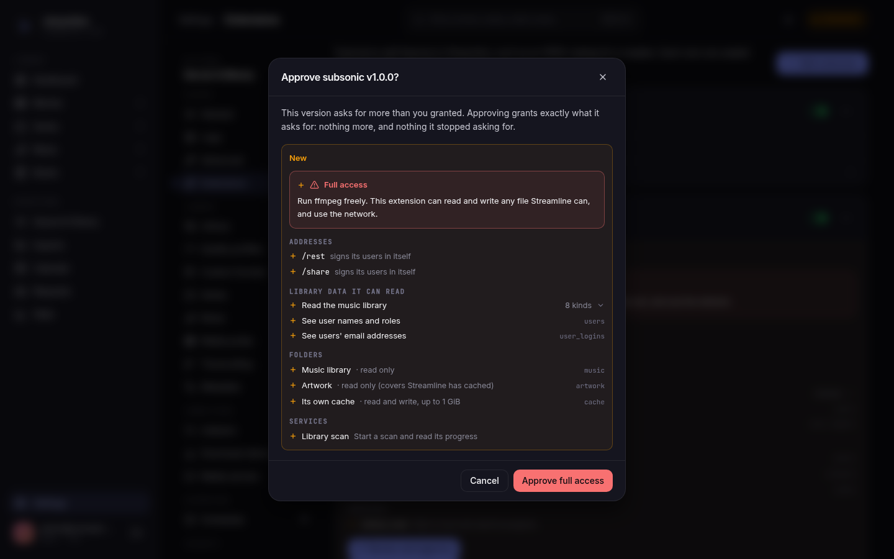

# Extensions

An extension is a small WebAssembly program that adds a feature to Streamline without being part of it. It can answer requests under a URL prefix of its own, read the parts of your library and the folders you allow, and keep its own database. Without the one exception below it cannot touch anything else: no file outside the folders you allowed, no password outside what its permissions name, no network. The exception is the **ffmpeg** permission, which is full trust, see [Approving permissions](#approving-permissions).

The first one is **OPDS**, the e-book catalogue e-reader apps read, published from [its own repository](https://github.com/Streamline-HQ/streamline-opds).

## Adding an extension

An extension is an entry under `extensions` in the config file:

```yaml
extensions:
  - name: opds
    source: https://github.com/Streamline-HQ/streamline-opds/releases/download/vX.Y.Z/opds.wasm
    sha256: <the module's checksum>
    enabled: true
```

| Field | Notes |
| --- | --- |
| `name` | Lower-case letters, digits and `-`, up to 32 characters, starting with a letter or digit. It must equal the name inside the module |
| `source` | An `https://` URL, or an absolute path to a `.wasm` file. Plain `http://` is refused |
| `sha256` | Required with a URL, optional with a path. Streamline refuses a module whose bytes do not match |
| `enabled` | `false` keeps the entry and stops the extension |
| `grants` | What you have allowed it, see [Approving permissions](#approving-permissions) |

An official extension's URL is a file on a release of its own repository (`opds.wasm`), and its checksum is in that release's `checksums.txt`. A URL is downloaded once and kept in `<data_dir>/extensions/_sources`, so later boots do not need the network.

An admin can also add one from **Settings → Extensions** in the web UI, which shows what the module asks for before anything is saved, or from the API (neither on a `read_only` instance, where the file is the only way in and the page gives you the entry to paste): `POST /api/v1/extensions` with `name`, `source`, `sha256`; `POST /api/v1/extensions/inspect` with the same body shows what a module asks for without saving anything. See [REST API](REST-API#extensions).

## Approving permissions

[](https://raw.githubusercontent.com/DataHearth/streamline/main/docs/assets/extensions-approve-desktop.png)

A module declares, in its manifest, what it needs:

- **mounts**: the URL prefixes it answers, and whether it checks credentials itself (`self`, as a reader app's Basic login) or uses Streamline's own sign-in.
- **views**: read-only slices of your library, such as "Read the book library" or "See users' email addresses". Some come in groups: the music library and the book library. Each view lists its columns in [Writing an extension](Writing-an-extension#views).
- **folders**: directories it can open.
  - `music`: your music library folder (`library.music_path`), read-only.
  - `movies` and `series`: your movie and series library folders (`library.movie_path`, `library.series_path`), read-only.
  - `artwork`: Streamline's own copies of covers, posters and artist photos, read-only.
  - `cache`: a folder of its own, `<data_dir>/extensions/<name>/cache`, which it can write. Streamline deletes its oldest files once it holds more than 1 GiB (checked every hour by the `extension-cache-sweep` job).
- **services**:
  - `serve_file`: send a book file to a client, for downloads.
  - `serve_poster`: send a book or author picture to a client.
  - `library_scan`: see whether the library scan (the `drift-check` job) is running, when it last finished and how many tracks have a file, and start one.
  - `http`: call other servers, but only the ones you list yourself under the entry's `hosts` in the config file (see below). With no host listed it can call nothing.
  - `ffmpeg`: run Streamline's ffmpeg and ffprobe with whatever options the extension chooses. Read the warning below before granting it.

> **Warning: `ffmpeg` is full trust.** The web UI lists it as **Run ffmpeg freely**: "This extension can read and write any file Streamline can, and use the network." That is meant literally. Streamline runs ffmpeg with the extension's own options and nothing confines it, so an extension holding this permission can read any file Streamline's account can read (your library, the config file and its secrets, the database), overwrite or create files anywhere Streamline can write, and reach any address on your network or the internet. Grant it only to an extension you trust as much as Streamline itself. ffmpeg must be enabled on Settings → Media probe for it to run at all.

A new entry has no grants, so it sits in **needs approval** and does not run. Approve it from Settings → Extensions or the API (`POST /api/v1/extensions/{name}/approve`), or write the lists into `grants` yourself. The entry must hold everything the module asks for: nothing is optional, and an update that asks for one more view needs approving again. Approving sets the grants to exactly what the module asks for, so one it stopped asking for is dropped then; until then a grant beyond the module's list stays in force.

```yaml
    grants:
      mounts: [/opds]
      views: [users, user_logins, books, book_series, authors, book_contributions, book_files]
      services: [serve_file, serve_poster]
```

For a module that asks for folders, `grants` carries a `folders` list beside the others (`folders: [music, artwork, cache]`).

A module holding the `http` service reaches only the servers named in `hosts`, which sits beside `grants` on the entry, each as `host:port` in lower case:

```yaml
    hosts: [engine.lan:8097]
```

`hosts` is written in the config file only: neither the web UI nor the API changes it, and approving an update never touches it. The port is part of the match, and a redirect is handed back to the extension rather than followed, so a listed server cannot send the call somewhere else.

A module can never use a mount that Streamline itself owns (`/api`, `/books`, `/music`, `/settings` and the other app pages), and two extensions cannot share a prefix. `/rest` and `/share` are not Streamline's: they are left for a Subsonic extension.

## States

| State | Meaning |
| --- | --- |
| `running` | Loaded and answering |
| `disabled` | `enabled: false` |
| `needs approval` | The module asks for more than the entry grants. It is not run |
| `failed` | It could not start: a source that is neither an `https://` URL nor an absolute path, an unreachable one, a missing or wrong checksum, a bad manifest, a name that differs from the entry's, a prefix already taken, or an in-memory core database. The reason is shown and logged; the rest of Streamline starts regardless |
| `starting` | A transient state while the server boots |

Changes made through the web UI or the API apply at once. A file edit is read at the next start.

An extension that is not running answers `404` on its mounts, to an app with no Streamline session too.

## What an extension serves

An extension answers on the same address as the web UI, so everything it serves is sent with a content policy Streamline sets itself: a page from an extension cannot run scripts, cannot read the web UI's session, and browsers do not guess a content type for it. It may show images and play audio from Streamline's own address. A reader app or an API client never notices.

## Where an extension's data lives

Each extension has its own database, `<data_dir>/extensions/<name>/data.db`, and, when it asks for one, its `cache` folder beside it. The database holds whatever the extension stores (OPDS keeps its reader tokens there). Removing an entry leaves the data alone, so re-adding it picks up where it left off; `DELETE /api/v1/extensions/{name}?purge=true` removes the directory too.

## Backups

The daily `database-backup` job snapshots every extension's database (never its cache folder) after Streamline's own, into `<data_dir>/backups/extensions/<name>`, keeping `backup.retention.scheduled` of them. A failing extension never fails the job; it logs a warning. Restoring one is a file copy: stop Streamline, copy the snapshot over `<data_dir>/extensions/<name>/data.db`, start it. See [Backups](GitOps-and-Kubernetes#backups).

## Signing in to an extension

An extension that serves reader or music apps gives each user a credential of its own. A running extension shows its card under **Account → Players & readers** in the web UI; the same is at `/api/v1/account/extensions/{name}/credential`: `GET` for its state, `POST` to generate or rotate (the secret is in that one response only), `DELETE` to disable.

## Writing your own

See [Writing an extension](Writing-an-extension).
