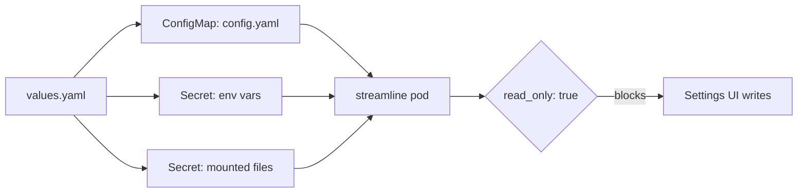

# GitOps and Kubernetes

Running Streamline declaratively: config from git, secrets from your secret store, nothing mutated at runtime.



- [Read-only mode](#read-only-mode)
- [The Helm chart](#the-helm-chart)
- [Storage layout](#storage-layout)
- [Secrets](#secrets)
- [Ingress and public URL](#ingress-and-public-url)
- [Library path migration](#library-path-migration)
- [Backups](#backups)

---

## Read-only mode

```yaml
read_only: true
```

Every runtime config write — `config.Update` — is refused with `ErrReadOnly`. The Settings pages render with a banner (*"This instance is configured externally and runs read-only. Editing controls are disabled."*) and their controls disabled; the corresponding API calls return an error rather than silently no-op'ing.

This is the right posture when your config file comes from git: without it, a change made in the UI is written to a file your next reconcile overwrites, so the change silently vanishes. Read-only mode turns that silent loss into an upfront refusal.

The Helm chart sets `read_only: true` by default.

### What you must supply yourself

Three values are normally generated on first boot and persisted back into the config. With read-only mode there's nowhere to persist them, so you have to provide them:

| Value | Consequence of omitting it |
| --- | --- |
| **`auth.session_secret`** | Falls back to an ephemeral secret regenerated at every start — every user is logged out on every restart and every pod reschedule |
| **`media_server.plex_client_id`** | A new client identity per restart; Plex sees a new device each time |
| **`auth.seed_admin.password`** | A generated password is printed once to the pod's stdout (`kubectl logs … \| grep 'default admin'`) and never persisted |

> [!WARNING]
> `auth.session_secret` is the one that will actually bite you — it's the row above, but easy to skip past in a table. Generate one and store it:

```bash
openssl rand -hex 32
```

```yaml
secrets:
  STREAMLINE_AUTH__SESSION_SECRET: "..."
```

Also note: **`registration_mode`, `session_ttl`, schedule intervals, indexers, download clients, media servers and quality profiles all become file-only** under read-only mode. Every change is a commit.

---

## The Helm chart

```bash
helm install streamline oci://ghcr.io/datahearth/charts/streamline \
  --namespace streamline --create-namespace \
  --version X.Y.Z -f values.yaml
```

The chart versions independently of the app: `--version` selects the *chart*, and `image.tag` (**required** since chart 2.2.0) selects the app — the chart has no default, so your values file pins the exact Streamline version and upgrades are an explicit `image.tag` bump in git. App releases are tagged `vX.Y.Z`, chart releases `chart-vX.Y.Z`.

### Non-negotiables

**`replicaCount: 1`.** SQLite is a single-writer database. A second replica corrupts it. There is no HA story; scale vertically.

**`podSecurityContext`.** The image runs as uid/gid 1000. The chart sets:

```yaml
podSecurityContext:
  runAsUser: 1000
  runAsGroup: 1000
  fsGroup: 1000
  runAsNonRoot: true
```

> [!IMPORTANT]
> `fsGroup` is what makes a root-owned RWO PVC (Ceph RBD, for instance) group-writable. Drop it and the pod crashloops on `unable to open database file (14)`.

**`server.port` must equal `service.port`.** Probes and the container port both target it.

### The config block

`values.yaml`'s `config:` is rendered into `/etc/streamline/config.yaml`. The chart deliberately carries **only keys that deviate from the binary's built-in defaults**, so it can't silently drift from them:

```yaml
config:
  data_dir: /data          # the binary default ./data is relative — must pin to the PVC
  read_only: true
  server:
    port: 8080
  log:
    app:
      format: json
  otel:
    endpoint: ""           # auto-set when observability.enabled; http:// also sets insecure
```

Add any other key and koanf merges it over the defaults. Check your result before rolling it out:

```bash
helm template streamline ... | yq '.data."config.yaml"' | streamline config validate
```

---

## Storage layout

### Data

```yaml
persistence:
  enabled: true
  size: 5Gi
  storageClass: ""
  accessMode: ReadWriteOnce
```

Holds the SQLite database and cached posters.

> [!WARNING]
> Keep it on local or block storage. SQLite locking over NFS or SMB is unreliable and will corrupt the database.

### Library

The chart defaults to **one shared volume mounted once**, which is what makes hardlinking work:

```yaml
library:
  shared:
    enabled: true
    mountPath: /srv
    size: 50Gi
```

The chart then points `config.library` at conventional subdirectories: `<mountPath>/media/movies`, `<mountPath>/media/series`, `<mountPath>/downloads`. Set those keys explicitly if you want a different layout and the chart leaves them alone.

Separate media and downloads volumes are available:

```yaml
library:
  shared:
    enabled: false
  media:
    enabled: true
    mountPath: /media
  downloads:
    enabled: true
    mountPath: /downloads
```

Two filesystems can't hardlink across each other, so **you must also set `config.library.import_mode` to `copy` or `move`** if you do this. It's the same constraint as [the folder rule](Installation#before-you-start-the-folder-rule), just in Kubernetes clothing.

---

## Secrets

Two mechanisms, for two shapes of secret.

### Scalars → environment variables

```yaml
secrets:
  STREAMLINE_METADATA__TMDB_API_KEY: "..."
  STREAMLINE_AUTH__SESSION_SECRET: "..."
```

Rendered into a Secret and mounted with `envFrom`, prefix preserved. Koanf's `STREAMLINE_*` env source overrides the file config.

Fine for flat keys. Useless for anything nested inside an array.

### Array-nested → mounted files

Indexer API keys, download-client passwords and OIDC client secrets all live inside YAML arrays, which don't map onto environment variables. Mount a pre-existing (SOPS-managed, sealed, whatever) Secret as files and reference the paths:

```yaml
secretFiles:
  enabled: true
  existingSecret: streamline-secrets
  mountPath: /etc/streamline/secrets
```

```yaml
config:
  indexers:
    - name: prowlarr
      protocol: prowlarr
      host: prowlarr.media.svc.cluster.local
      port: 9696
      api_key_file: /etc/streamline/secrets/prowlarr-key
      enabled: true
  auth:
    oidc:
      - name: authentik
        issuer: https://auth.example.com/application/o/streamline/
        client_id: streamline
        client_secret_file: /etc/streamline/secrets/oidc-secret
```

Each Secret key becomes a file under `mountPath`. The ConfigMap stays free of secret values while the config itself remains fully declarative and reviewable.

Every secret-bearing key has a `_file` twin — the full list is in the [Configuration Reference](Configuration-Reference#secrets).

---

## Ingress and public URL

```yaml
ingress:
  enabled: true
  className: nginx
  hosts:
    - host: streamline.example.com
      paths: [{ path: /, pathType: Prefix }]
  tls:
    - secretName: streamline-tls
      hosts: [streamline.example.com]
```

Gateway API is supported as an alternative:

```yaml
gateway:
  enabled: true
  parentRefs: [{ name: my-gateway, namespace: gateway-system }]
  hostnames: [streamline.example.com]
```

Make sure whatever's in front forwards `X-Forwarded-Proto`, **and** that `server.trusted_proxies` names it — the header is ignored from an untrusted peer, which loops logins (no `Secure` cookie) and makes OIDC send an `http://` `redirect_uri` your IdP will reject:

```yaml
config:
  server:
    trusted_proxies:
      - 10.42.0.7/32   # the ingress controller pod, not the pod CIDR
```

**OIDC redirect URIs are derived per-request from the host you connect on**, so multi-domain SSO needs no configuration — just register each domain's `/auth/oidc/<name>/callback` at your IdP.

`STREAMLINE_PUBLIC_URL` only sets the canonical base for **invite links**. Without it they fall back to `http://<host>:<port>`, which is ugly but harmless:

```yaml
extraEnv:
  - name: STREAMLINE_PUBLIC_URL
    value: https://streamline.example.com
```

---

## Library path migration

Moved your library, or re-pointed a mount? Changing `library.movie_path` alone doesn't help — every stored file path still carries the old prefix, so Streamline loses track of files that are physically present.

Path migration rewrites those stored paths.

**Check what's tracked where first:**

```bash
curl -sS -H "X-API-Key: $KEY" $SL/api/v1/library/path-migration/roots
```

Each root reports `tracked`, the number of stored paths currently under its configured prefix. **`tracked: 0` on a non-empty library means the config was re-pointed without the stored paths following** — which is exactly the situation migration fixes, and it means you must supply the old prefix explicitly via `from`.

**Preview before committing:**

```bash
curl -sS -X POST -H "X-API-Key: $KEY" -H 'Content-Type: application/json' \
  -d '{"root":"movies","from":"/old/media/movies","to":"/srv/data/media/movies"}' \
  $SL/api/v1/library/path-migration/preview
```

**Run it:**

```bash
curl -sS -X POST -H "X-API-Key: $KEY" -H 'Content-Type: application/json' \
  -d '{"root":"movies","to":"/srv/data/media/movies","move_files":false}' \
  $SL/api/v1/library/path-migration
```

| Field | Notes |
| --- | --- |
| `root` | `movies` \| `series` \| `downloads` |
| `from` | Old prefix. Defaults to the root's current configured value |
| `to` | New prefix |
| `move_files` | If true, relocate each file first — a rename when both sides share a filesystem, a copy when they don't. **Rejected for the `downloads` root**, since that data belongs to your download client |

Returns `202`; it runs in the background. Poll `GET /library/path-migration` for progress. Only one migration runs at a time (`409` otherwise).

It's also available in the UI at **Settings → Advanced** — *"Maintenance tools that rewrite stored data. Preview before you run anything here."* Take that literally: preview first.

Migration also re-points the config at the new root, which under `read_only: true` will be refused — so in a GitOps deploy, update the path in git and let the migration handle only the stored rows.

---

## Backups

The database, `<data_dir>/streamline.db`, is the irreplaceable part: library contents, request history, users, API keys, monitoring state. Your config file lives in git (or is rendered by the chart), and your media is your media.

Streamline backs the database up itself, into **`<data_dir>/backups`**:

| Kind | When | Kept (default) |
| --- | --- | --- |
| `pre-migration` | At boot, before a new version applies its database migrations — only when there is something to apply | 5 (`backup.retention.pre_migration`) |
| `scheduled` | Daily, by the `database-backup` job ([Scheduled Jobs](Scheduled-Jobs)) | 7 (`backup.retention.scheduled`) |
| `manual` | `streamline backup` | 10 (`backup.retention.manual`) |
| `pre-restore` | The database a `streamline restore` replaced | never pruned |

Each backup is one self-contained file written with SQLite's `VACUUM INTO`: consistent, safe to take while Streamline runs, and with no `-wal`/`-shm` to carry along. It is named `streamline-<kind>-<schema version>-<UTC time>.db`, owner-only (`0600`, in a `0700` directory), since it holds password hashes, API key hashes and sessions.

**The pre-migration backup is what makes automated updates safe.** With Renovate, Flux or Argo CD rolling out new images, a new version boots and migrates with nobody there to take a copy. Streamline takes it first; if the copy fails (a full disk, most often) it **refuses to migrate** and the pod fails to start with the reason in its log, rather than migrating without a way back. For a database too large to copy on every upgrade, set `backup.pre_migration: false` and back up some other way.

### From the command line

Both commands need the same configuration as the server — pass the same `--config` (or the same `STREAMLINE_*` environment), since that is where `data_dir` comes from.

```bash
streamline --config config.yaml backup          # a manual backup; prints its path
streamline --config config.yaml backup list     # every backup, newest first
streamline --config config.yaml restore <file>  # a path, or a name from `backup list`
```

`streamline backup` works with the server running or stopped, and never migrates the database: a newer binary run for a backup before an upgrade copies the database as it stands.

`streamline restore` needs the server **stopped** — it refuses while anything holds the database open. It checks the file before touching anything: it must open, pass SQLite's integrity check, and hold a schema version no newer than the binary's (restore a newer backup with the release that wrote it). The database it replaces is kept in `<data_dir>/backups` as a `pre-restore` backup, so restoring the wrong file can be undone with another restore. Restoring an older backup with a newer binary is fine: the next start migrates it forward, taking a pre-migration backup first. Into a `data_dir` that holds no database yet (a new machine), add `--force` — without it, a restore pointed at the wrong configuration would land where nothing reads it.

```bash
docker compose stop streamline
docker compose run --rm streamline --config /etc/streamline/config.yaml restore streamline-pre-migration-20261021140000-20261026T020000Z.db
docker compose start streamline
```

On Kubernetes, scale to zero and run the restore from a pod mounting the same PVC, with the same image and config:

```bash
kubectl scale -n streamline deploy/streamline --replicas=0
# in a helper pod using the streamline image, the config and the data PVC:
streamline --config /etc/streamline/config.yaml restore <file>
kubectl scale -n streamline deploy/streamline --replicas=1
```

### Off the machine

`<data_dir>/backups` sits on the same disk as the database, so it protects against a bad migration or a mistake, not against losing the disk. Copy it elsewhere too — any backup file can be copied while Streamline runs, since each is complete once it appears under its final name. On Kubernetes, a PVC volume snapshot (CSI snapshots, Velero) of the data volume carries it along.

To pull the newest backup out of a running pod (the image has no `sqlite3`, but it does not need one):

```bash
f=$(kubectl exec -n streamline deploy/streamline -- streamline --config /etc/streamline/config.yaml backup)
kubectl exec -n streamline deploy/streamline -- cat "$f" > "./$(basename "$f")"
```

Copying `streamline.db` by hand instead needs the server stopped, or its `-wal` and `-shm` files taken at the same instant — a hot copy of `streamline.db` alone is missing recent writes. `streamline restore` refuses a file with a non-empty `-wal` beside it for that reason.
